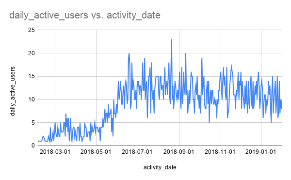
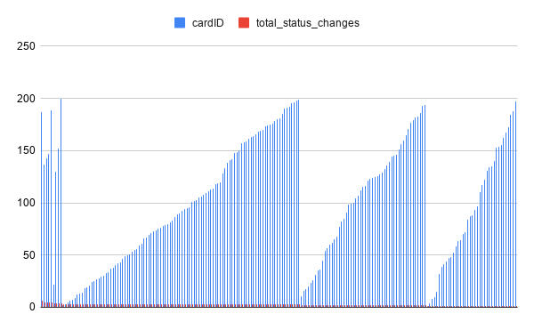

# Shiptivitas Product Analytics Report

## Executive Summary
Following the recent deployment of the interactive Kanban board feature on the Shiptivitas platform, we conducted a product analytics review to measure its impact on user engagement. By analyzing our database's `login_history` and `card_change_history`, we established a baseline for Daily Active Users (DAU) and tracked task velocity. This report outlines our data findings and proposes three data-driven product features designed to further accelerate DAU growth and platform stickiness.

---

## 1. SQL Data Extraction

The following SQL queries were executed against the production database to extract the necessary metrics for our analysis.

**Query 1: Daily Active Users (Before and After Feature Change)**
*Purpose: To measure unique daily logins to visualize the macro-level impact of the Kanban release.*

```sql
SELECT 
    DATE(login_timestamp, 'unixepoch') AS activity_date, 
    COUNT(DISTINCT user_id) AS daily_active_users
FROM 
    login_history 
GROUP BY 
    DATE(login_timestamp, 'unixepoch')
ORDER BY 
    activity_date ASC;
```
*Technical Note: We utilized the `unixepoch` modifier to convert the integer timestamps into readable YYYY-MM-DD formats, grouping by date and ensuring duplicate logins from the same user on the same day were only counted once (`COUNT(DISTINCT)`).*

**Query 2: Number of Status Changes by Card**
*Purpose: To identify which shipping request cards required the most manual intervention and status updates across the board.*

```sql
SELECT 
    cardID, 
    COUNT(id) AS total_status_changes
FROM 
    card_change_history
WHERE 
    oldStatus IS NOT newStatus
GROUP BY 
    cardID
ORDER BY 
    total_status_changes DESC;
```
*Technical Note: We explicitly filtered for `oldStatus IS NOT newStatus`. This ensures we are only counting meaningful transitions between workflow stages (e.g., Backlog -> In Progress) and excluding minor vertical priority reshuffling within the same column.*

---

## 2. Data Visualizations & Analysis

### Daily Active Users (DAU) Over Time



**Analysis:**
The DAU graph illustrates a dramatic, sustained shift in user behavior. Prior to May 2018, daily active users hovered consistently below 5 per day. Following the introduction of the new feature set around May/June, we observed an immediate growth phase, peaking at 20+ DAU before stabilizing into a healthy, consistent baseline of 10-15 active users per day. This proves that the interactive Kanban board successfully transformed Shiptivitas from an occasional-use tool into a daily operational necessity for freight managers.

### Total Status Changes by Card



**Analysis:**
This distribution graph reveals the lifecycle volatility of our shipping cards. Rather than a flat distribution, we see a repeating, stepped pattern indicating distinct cohorts of cards. Some cards move smoothly through the pipeline with minimal touches, while others require high-frequency status changes (approaching 200+ touches). This indicates potential bottlenecks or "problem shipments" that require excessive back-and-forth by the freight managers.

---

## 3. Actionable Feature Proposals

Based on the goal of continuing our DAU growth and addressing the high-touch card issues identified in the data, I propose the following three features:

### Idea 1: The "Morning Briefing" Dashboard
* **Hypothesis:** If users are greeted with a curated, actionable list of their most urgent tasks immediately upon opening the app, they will form a daily habit of using Shiptivitas as their mandatory start-of-day checklist.
* **Expected Impact:** A steady, baseline increase in DAU through habit formation, and a 15% faster resolution time for high-priority shipping requests.
* **What the feature is:** A personalized daily digest view that intercepts the first login of the day. Instead of looking at the overwhelming full board, users see a targeted list of "Cards assigned to you," "Priority shipments for today," and "Cards stuck in progress."
* **User Flow:** User logs in -> Modal pops up showing 3 urgent cards -> User clicks a card -> App routes them directly to that card on the Kanban board.
* **Metrics to Track:** Digest click-through rate (CTR), Time to first action per session.

### Idea 2: Real-Time Activity Feed & Card Comments
* **Hypothesis:** If team members can communicate directly on a card and see their colleagues moving items in real-time, they will log into Shiptivitas for collaboration rather than relying on external tools like Slack or email.
* **Expected Impact:** Higher DAU and longer session durations, as the application transitions from a simple tracking database into a central, live communication hub for the freight team.
* **What the feature is:** Implementing a real-time WebSocket connection to show a live feed of who is moving what card on the right sidebar, alongside a comment section inside each Kanban card where users can `@mention` colleagues.
* **User Flow:** User opens board -> Sees a typing indicator or live card movement -> Opens card details -> @mentions a colleague to ask for an update -> Colleague receives an email/push notification pulling them into the app.
* **Metrics to Track:** Comments created per user per day, Session duration length, Notification open rate.

### Idea 3: Gamified Activity Streaks
* **Hypothesis:** If we gamify daily task management by rewarding consecutive days of activity, users will be psychologically motivated to log in and make at least one meaningful update every day to keep their streak alive.
* **Expected Impact:** A significant bump in DAU, particularly on historically low-traffic days (like Fridays or weekends), driven by the psychological desire to maintain progress.
* **What the feature is:** A visual "Streak" tracker in the navigation bar (similar to language-learning apps) that increments for every consecutive day a user logs in and moves a card. Moving a card to "Complete" triggers a satisfying UI animation.
* **User Flow:** User logs in -> Moves a card -> Flame icon in navbar animates and ticks from "3 Days" to "4 Days" -> Confetti animation plays.
* **Metrics to Track:** Weekend DAU, Week 1 to Week 2 User Retention Rate.